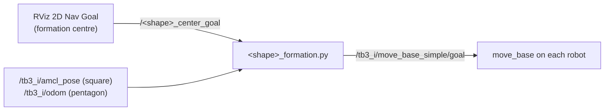

# Multi-Robot Formation Control (ROS Noetic)

Formation controllers for groups of **TurtleBot3 Burger** robots. You click one centre point in RViz, and the node works out a vertex of a triangle, square or pentagon for each robot and sends it to that robot's `move_base`. The square and pentagon nodes then wait for every robot to arrive and rotate the robots around the shape.

This was run on real TurtleBot3 robots, with up to five at once, on top of [turtlebot3_multirobot_navigation](https://github.com/adithya2204/turtlebot3_multirobot_navigation).

| Repository | Role |
|---|---|
| [turtlebot3-multirobot-setup-guide](https://github.com/adithya2204/turtlebot3-multirobot-setup-guide) | Step-by-step setup: Raspberry Pi, networking, SLAM, multi-robot bringup |
| [turtlebot3_multirobot_navigation](https://github.com/adithya2204/turtlebot3_multirobot_navigation) | Per-robot localisation and navigation on a shared map |
| **multi_robot_formation** (this repo) | Triangle, square and pentagon formation controllers |

---

## How it works



Each node is a goal planner, not a low-level controller. Path planning and obstacle avoidance are handled by each robot's own `move_base`. All goals are `PoseStamped` messages in the `map` frame with zero yaw.

| Script | Robots | Shape around the clicked centre | After arrival |
|---|---|---|---|
| `triangle_formation.py` | `tb3_0` to `tb3_2` | Vertices at 0°, 120° and 240° on a 0.30 m radius (side ≈ 0.52 m) | One-shot: goals are sent once per click |
| `square_formation.py` | `tb3_0` to `tb3_3` | Corners at (±0.354, ±0.354) m, i.e. 0.50 m from the centre (side ≈ 0.71 m) | Waits until all four are within 0.15 m (from `amcl_pose`), holds 30 s, then moves every robot to the next corner counter-clockwise. This repeats indefinitely. |
| `pentagon_formation.py` | `tb3_0` to `tb3_4` | Vertices every 72° on a 0.255 m radius (0.30 m side) | Waits until all five are within 0.08 m (from `odom`), pauses 1 s, then makes one neighbour swap (robot *i* goes to vertex *i*+1) |

A new click on the centre topic recomputes the shape and starts the cycle again.

---

## Requirements

- Ubuntu 20.04 and ROS Noetic
- [turtlebot3_multirobot_navigation](https://github.com/adithya2204/turtlebot3_multirobot_navigation) running for the robots you use (namespaces `tb3_0`, `tb3_1`, …)

## Installation

```bash
cd ~/catkin_ws/src
git clone https://github.com/adithya2204/multi_robot_formation.git
cd ~/catkin_ws && catkin_make
source devel/setup.bash
```

## Usage

1. Bring up the robots and start multi-robot navigation, then set each robot's pose in RViz (see the [setup guide](https://github.com/adithya2204/turtlebot3-multirobot-setup-guide)):
   ```bash
   roslaunch turtlebot3_multirobot_navigation multirobot.launch
   ```
2. Start one formation node:
   ```bash
   rosrun multi_robot_formation triangle_formation.py   # or square_ / pentagon_formation.py
   ```
3. In RViz, choose the formation-centre goal tool and click where the formation should go. The layout in the navigation package has three extra *2D Nav Goal* tools after the five per-robot ones:

   | Goal tool | Topic |
   |---|---|
   | 6th | `/triangle_center_goal` |
   | 7th | `/square_center_goal` |
   | 8th | `/pentagon_center_goal` |

   Without RViz, you can publish the centre from the command line:
   ```bash
   rostopic pub -1 /triangle_center_goal geometry_msgs/PoseStamped \
     '{header: {frame_id: map}, pose: {position: {x: 1.0, y: 0.5}, orientation: {w: 1.0}}}'
   ```

Formation sizes are set where each node is constructed, at the bottom of each script (`radius=0.3`, `side=0.5, tolerance=0.15, wait_time=30.0`, `side=0.3`).

---

## Known issues

These are left as they were when the robots were tested.

- **The pentagon node checks arrival in the wrong frame.** It reads `/tb3_i/odom` but compares those positions with goals in the `map` frame. Unless a robot's `odom` frame happens to line up with `map`, the arrival check won't pass and the neighbour swap won't fire. The square node reads `amcl_pose`, which is in `map`.
- **The square's `side` argument is really the centre-to-corner distance.** The corners are placed at (±r, ±r) with r = side/√2, so the actual side is √2 × `side`. Also, the code comment says "clockwise", but the corner order is counter-clockwise in `map`.
- **Robot names are hard-coded** (`tb3_0` to `tb3_4`).

## Repository layout

```
multi_robot_formation/
├── scripts/
│   ├── triangle_formation.py
│   ├── square_formation.py
│   └── pentagon_formation.py
├── CMakeLists.txt
└── package.xml
```

## Acknowledgements

Built during a summer internship in the Systems and Control Lab, Department of Electrical Engineering, IIT Madras (July 2025).

**Author:** Adithya Pothula

## License

Apache License 2.0. See [LICENSE](LICENSE).
