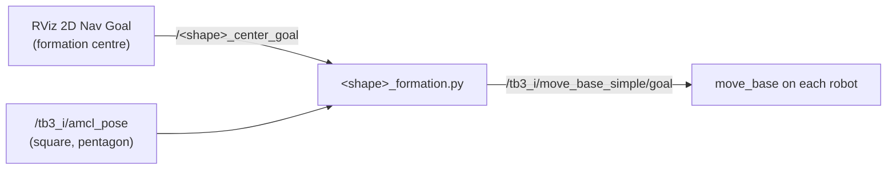
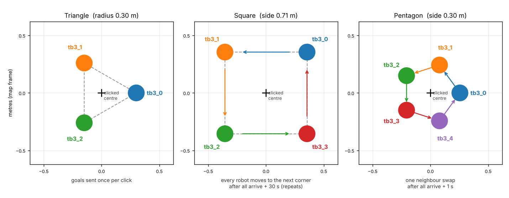

# Multi-Robot Formation Control (ROS Noetic)

Formation controllers for groups of **TurtleBot3 Burger** robots. You click one centre point in RViz, and the node works out a vertex of a triangle, square or pentagon for each robot and sends it to that robot's `move_base`. The square and pentagon nodes then wait for every robot to arrive and rotate the robots around the shape.

This was run on real TurtleBot3 robots, with up to five at once, on top of [turtlebot3_multirobot_navigation](https://github.com/adithya2204/turtlebot3_multirobot_navigation).

| Repository | Role |
|---|---|
| [turtlebot3-multirobot-setup-guide](https://github.com/adithya2204/turtlebot3-multirobot-setup-guide) | Step-by-step setup: Raspberry Pi, networking, SLAM, multi-robot bringup |
| [turtlebot3_multirobot_navigation](https://github.com/adithya2204/turtlebot3_multirobot_navigation) | Per-robot localisation and navigation on a shared map |
| **multi_robot_formation** (this repo) | Triangle, square and pentagon formation controllers |

---

## How it works



Each node is a goal planner, not a low-level controller. Path planning and obstacle avoidance are handled by each robot's own `move_base`. All goals are `PoseStamped` messages in the `map` frame with zero yaw.



| Script | Robots | Shape around the clicked centre | After arrival |
|---|---|---|---|
| `triangle_formation.py` | `tb3_0` to `tb3_2` | Vertices at 0°, 120° and 240° on a 0.30 m radius (side ≈ 0.52 m) | One-shot: goals are sent once per click |
| `square_formation.py` | `tb3_0` to `tb3_3` | Square with a 0.71 m side, corners at (±0.355, ±0.355) m | Waits until all four are within 0.15 m (from `amcl_pose`), holds 30 s, then moves every robot to the next corner counter-clockwise. This repeats indefinitely. |
| `pentagon_formation.py` | `tb3_0` to `tb3_4` | Vertices every 72° on a 0.255 m radius (0.30 m side) | Waits until all five are within 0.15 m (from `amcl_pose`), pauses 1 s, then makes one neighbour swap (robot *i* goes to vertex *i*+1) |

A new click on the centre topic recomputes the shape and starts the cycle again.

---

## Requirements

- Ubuntu 20.04 and ROS Noetic
- [turtlebot3_multirobot_navigation](https://github.com/adithya2204/turtlebot3_multirobot_navigation) running for the robots you use (namespaces `tb3_0`, `tb3_1`, …)

## Installation

```bash
cd ~/catkin_ws/src
git clone https://github.com/adithya2204/multi_robot_formation.git
cd ~/catkin_ws && catkin_make
source devel/setup.bash
```

## Usage

1. Bring up the robots and start multi-robot navigation, then set each robot's pose in RViz (see the [setup guide](https://github.com/adithya2204/turtlebot3-multirobot-setup-guide)):
   ```bash
   roslaunch turtlebot3_multirobot_navigation multirobot.launch
   ```
2. Start one formation node:
   ```bash
   rosrun multi_robot_formation triangle_formation.py   # or square_ / pentagon_formation.py
   ```
3. In RViz, choose the formation-centre goal tool and click where the formation should go. The layout in the navigation package has three extra *2D Nav Goal* tools after the five per-robot ones:

   | Goal tool | Topic |
   |---|---|
   | 6th | `/triangle_center_goal` |
   | 7th | `/square_center_goal` |
   | 8th | `/pentagon_center_goal` |

   Without RViz, you can publish the centre from the command line:
   ```bash
   rostopic pub -1 /triangle_center_goal geometry_msgs/PoseStamped \
     '{header: {frame_id: map}, pose: {position: {x: 1.0, y: 0.5}, orientation: {w: 1.0}}}'
   ```

### Parameters

Each node reads private ROS parameters. The defaults are the values used in testing.

| Node | Parameter | Default | Meaning |
|---|---|---|---|
| `triangle_formation.py` | `~radius` | 0.3 | centre-to-vertex distance (m) |
| `square_formation.py` | `~side` | 0.71 | side length (m) |
| | `~tolerance` | 0.15 | arrival distance (m) |
| | `~wait_time` | 30.0 | hold time before rotating (s) |
| `pentagon_formation.py` | `~side` | 0.3 | side length (m) |
| | `~tolerance` | 0.15 | arrival distance (m) |

```bash
rosrun multi_robot_formation square_formation.py _side:=0.5 _wait_time:=10.0
```

Keep the tolerances at or above `move_base`'s goal tolerance (0.15 m in the navigation package). `move_base` can stop anywhere inside that radius, so a tighter check may never pass.

---

## Known limitations

- **Robot names are hard-coded** (`tb3_0` to `tb3_4`).
- **The pentagon has not been re-run on hardware since its fixes.** It now checks arrival against `amcl_pose` within 0.15 m. The lab runs used the earlier code.

## Repository layout

```
multi_robot_formation/
├── scripts/
│   ├── triangle_formation.py
│   ├── square_formation.py
│   └── pentagon_formation.py
├── images/formations.png        # figure for this README
├── CMakeLists.txt
└── package.xml
```

## Acknowledgements

Built during a summer internship in the Systems and Control Lab, Department of Electrical Engineering, IIT Madras (July 2025).

**Author:** Adithya Pothula

## License

Apache License 2.0. See [LICENSE](LICENSE).
